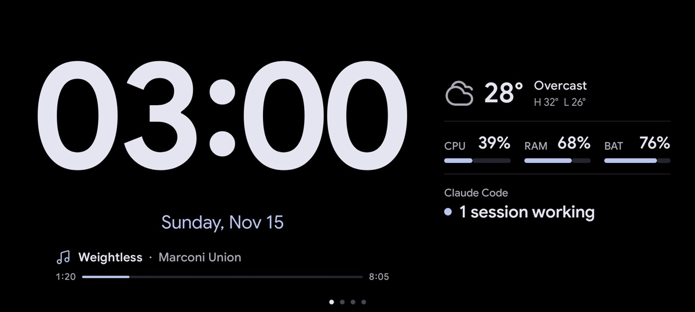
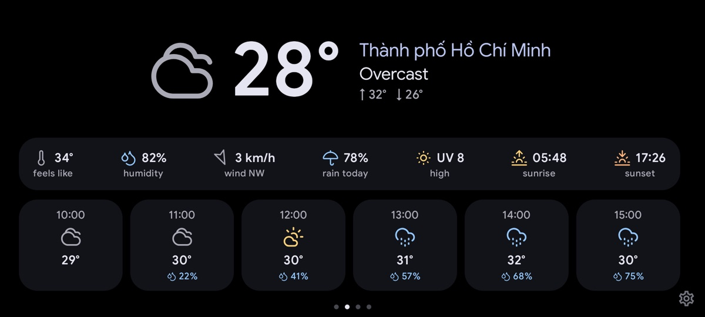
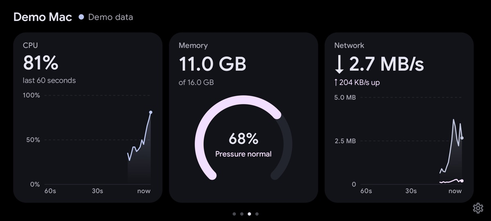
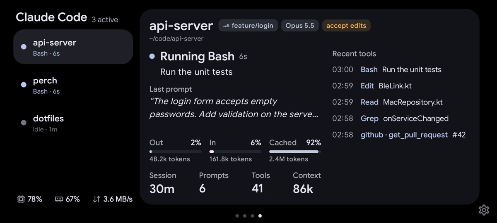
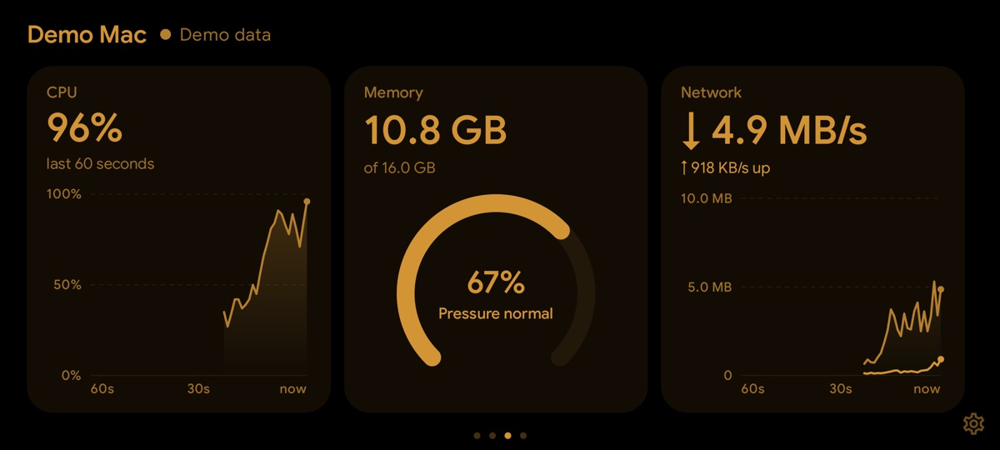

# Perch

A StandBy-style bedside/desk display for Android 16–17, plus a small Mac companion that streams
CPU, memory, network, battery, Now Playing and Claude Code session status to it over Bluetooth
Low Energy.



| Weather | Mac |
| --- | --- |
|  |  |
| **Claude Code** | **Night mode (amber)** |
|  |  |

<sub>Screenshots use the app's built-in demo data on the Android emulator.</sub>

```
android/   Kotlin + Jetpack Compose (Material 3) app — clock, weather, Mac and Claude Code pages
mac/       Swift menu bar agent — BLE peripheral, `perch hook` for Claude Code, Now Playing helper
docs/      README screenshots
tools/     svg2vector.py — converts Lucide SVG icons into Android vector drawables
```

## Android

```bash
cd android && ./gradlew :app:installDebug
```

- Swipe left/right between **Clock**, **Weather**, **Mac** and **Claude Code**; swipe up/down on the clock to change face.
- The clock page also shows the Mac's battery (a BAT bar: normal on power, yellow on battery, red below 20%)
  and what it is playing. Tap anywhere to reveal ⚙ for 5 seconds.
- The weather page shows feels-like, humidity, wind, chance of rain, UV and sunrise/sunset as icons.
- The Mac page graphs CPU and network over the last 60 seconds with labelled axes, plus a memory gauge.
- The **Claude Code** page lists sessions (those needing you first) and shows the selected one's
  current tool, waiting reason, last prompt, model, git branch, permission mode, prompt/tool counts,
  token usage, context size and recent tool calls. Tapping a session selects it for two minutes
  and shows a bin on its row for 3 s; tap the bin, then the tick, to clear a finished session.
  A session that is still running reappears on its next action.
- To show it automatically while charging: ⚙ → *Screen saver settings* → pick **Perch**
  (on Samsung: Settings → Display → Screen saver).
- In a dark room the whole display turns one dim colour: red, amber, green, soft white or blue (⚙ → *Night mode in the dark*).
- Weather comes from [Open-Meteo](https://open-meteo.com) (no key) using coarse location, or a city set in ⚙.
- On an emulator the Mac page uses simulated data (toggle *Demo Mac data* in ⚙).

## Mac

```bash
cd mac && ./install-hooks.sh
```

This builds `Perch.app`, copies it to `/Applications`, adds `perch hook` to the Claude Code hooks in
`~/.claude/settings.json` (a backup is written next to it), and starts the app. Allow Bluetooth
access when macOS asks. Add Perch to *System Settings → General → Login Items* to start it at login.

The first time a phone connects, accept the Bluetooth pairing request on both the phone and the Mac:
battery, Now Playing and Claude session details only travel over a paired (encrypted) link.

Now Playing comes from `media/PerchMedia.m`, which the agent loads into `/usr/bin/perl` because
macOS 15.4+ only answers Now Playing queries from Apple-signed processes.

Claude status per session: **working** (prompt submitted / tools running), **needs you**
(a `Notification` hook: permission request or waiting for input), **idle** (stopped).

## Tested devices

| Device | OS | How | Result |
| --- | --- | --- | --- |
| Samsung Galaxy A25 5G (SM-A256E) | Android 16 | Physical, paired with the Mac | All pages, live Mac data, encrypted channels, night mode, session removal, scrolling with 13 sessions |
| Google Pixel 11 Pro | Android 17 | Physical | Installs and connects; clock, weather and the unencrypted Mac/Claude summaries work. Pairing was not completed, so battery, Now Playing and Claude session details were not tested |
| Android Emulator, Medium Phone | Android 17 (API 37) | Demo data | All pages, night mode colours, battery colour states |
| MacBook Air (M5) | macOS 27.2 | Mac agent | BLE peripheral, Claude Code hooks, battery, Now Playing via Apple Music (including repeat) |

## Protocol

BLE service `8f1e0001-6d2a-4b7c-9c41-5065726368aa`, Mac = peripheral, phone = central.

| UUID suffix | Direction | Encrypted | Content |
| --- | --- | --- | --- |
| `…0002` | Mac → phone, notify | no | CPU, memory, network (binary) |
| `…0003` | Mac → phone, notify | no | Claude session summary (binary) |
| `…0004` | read | no | Mac name |
| `…0005` | Mac → phone, notify | yes | Claude session details, chunked JSON |
| `…0006` | Mac → phone, notify | yes | Battery and Now Playing, chunked JSON |
| `…0007` | phone → Mac, write | yes | Commands, e.g. `remove:<session id>` |

`perch sessions` prints exactly what is sent on `…0005`. Byte layouts live in
`mac/Sources/perch/Protocol.swift` and `android/.../data/MacModels.kt`.

Fonts and icons: Google Sans (OFL) and Lucide icons (ISC) — see [THIRD_PARTY.md](THIRD_PARTY.md).
